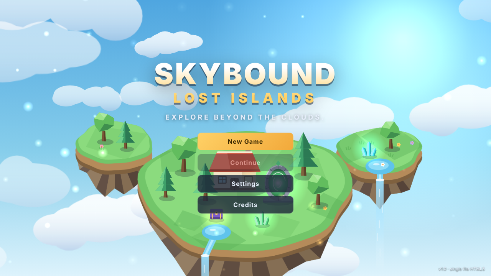
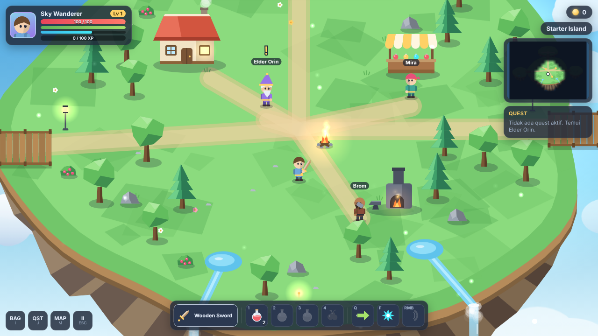
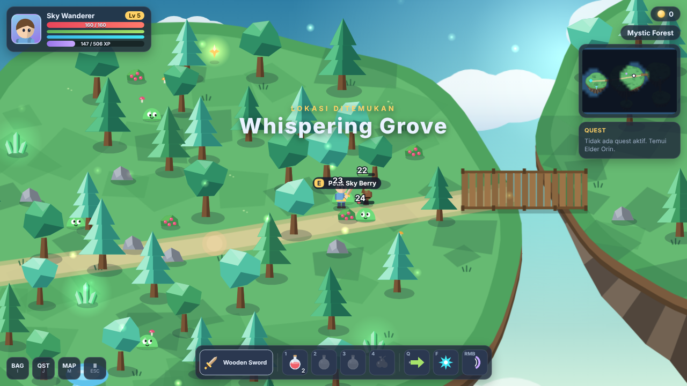
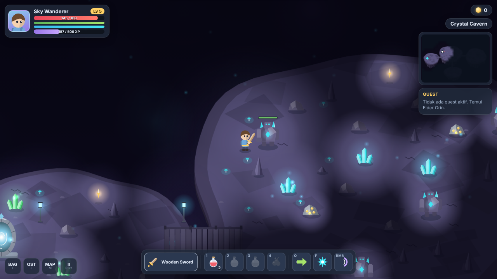
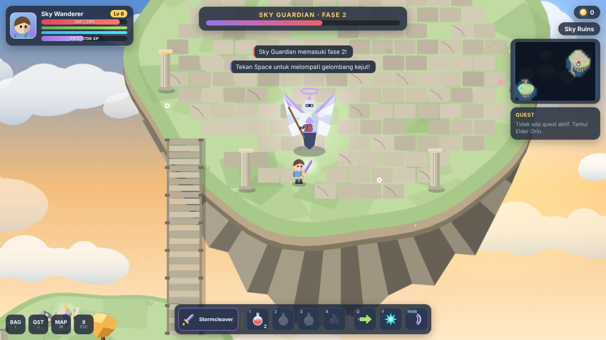
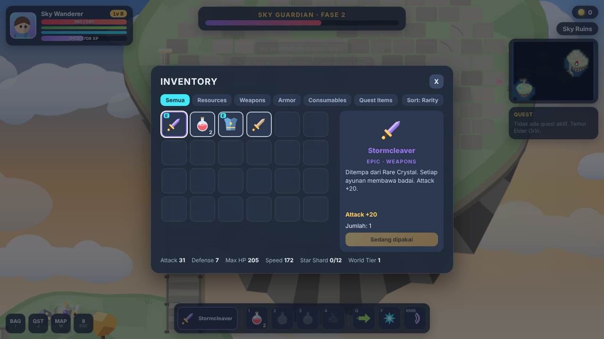

# SKYBOUND: LOST ISLANDS

Explore Beyond the Clouds.

A top-down action RPG about exploring floating islands above the clouds, gathering resources, fighting monsters, and defeating the Sky Guardian. The whole game runs from a single HTML file, with no frameworks, no external assets, and no build step.

Play it here: https://RelleNo1.github.io/skybound-lost-islands/



## Features

- 4 explorable areas: Starter Island, Mystic Forest, Crystal Cavern, and Sky Ruins, each with its own palette, resources, enemies, and difficulty
- Real-time combat: basic attack, charged attack, area skill (Sky Burst), ranged skill (Wind Slash), dodge with invulnerability frames, and jump
- 6 enemy types with a state machine AI (idle, patrol, chase, attack, hurt, death), including the Crystal Warden mini boss and the Sky Guardian, a three phase final boss
- Resource gathering (Wood, Stone, Green Crystal, Rare Crystal, Gold) with respawn timers
- Inventory with categories, item rarity (Common to Legendary), sorting, and equipment
- XP and leveling, 6 quests (available, active, completed), merchant shop, and a blacksmith for upgrades and crafting
- Fog of war, area discovery, secret locations, hidden treasure, and collectible Star Shards
- HUD with minimap, world map, notifications, pause menu, and death screen
- Procedural music and sound effects generated with the Web Audio API, with volume settings
- Save system using localStorage (autosave, manual save, continue, new game)
- World Tier system for replaying with stronger enemies after beating the final boss
- Virtual joystick and buttons for touch screens

## Screenshots

| Starter Island | Mystic Forest |
|---|---|
|  |  |

| Crystal Cavern | Boss fight |
|---|---|
|  |  |



## Controls

| Key | Action |
|---|---|
| W A S D | Move |
| Shift | Sprint |
| Space | Jump (also dodges boss shockwaves) |
| Q | Dodge |
| Left click | Basic attack toward the mouse |
| Hold left click | Charged attack |
| F | Sky Burst (area skill) |
| Right click | Wind Slash (unlocks at level 4) |
| E | Interact, talk, gather |
| 1 2 3 4 | Use hotbar items |
| I / J / M | Inventory / Quest log / World map |
| Esc | Pause or close a menu |

## How to run

Download or clone the repository and open `index.html` in a modern browser (Chrome, Edge, or Firefox). No server or installation is needed.

```bash
git clone https://github.com/USERNAME/skybound-lost-islands.git
```

## Technical overview

- HTML5 Canvas 2D for all rendering. Every character, tree, crystal, and icon is drawn procedurally in code.
- Game loop with `requestAnimationFrame` and delta time, with update logic separated from render logic
- Camera follow with smoothing and screen shake
- Collision against island shapes and solid objects
- Y sorted draw list for a pseudo 3D look
- Island terrain pre rendered to offscreen canvases, also reused for the minimap and world map
- Object pooling for particles
- Dynamic lighting in the cave using a low resolution light map
- Data driven design: items, enemies, quests, NPCs, and areas are plain JavaScript objects, so new content can be added without touching the engine

## Project structure

```
index.html        the complete game (HTML, CSS, JavaScript)
screenshots/      images used in this README
```

## Credits

Created by Abyan Fayzul Haq. Game design specification and testing by the author, with code written using Claude (Anthropic) as an AI coding assistant.

## License

MIT License. See [LICENSE](LICENSE).
